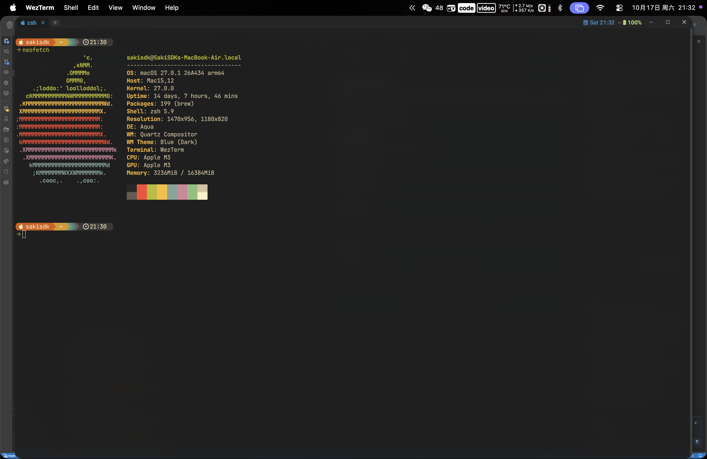

<div align="center">

# SakiSDK's macOS Dotfiles

**🚀 打造极致高效的 macOS 平铺窗口与终端工作流**

我的 macOS 生产力环境配置仓库，主要围绕窗口管理、终端体验、Shell 效率工具和快捷键工作流构建。

[](https://www.apple.com/macos/)
[](https://github.com/nikitabobko/AeroSpace)
[](https://github.com/koekeishiya/skhd)
[](https://wezfurlong.org/wezterm/)

</div>

---

## 📖 项目简介

这套配置的目标很简单：**让 macOS 上的日常开发环境更稳定、更顺手，也更适合高频键盘操作。**

目前主要包含以下核心组件：

- 🚀 **`AeroSpace`**：负责平铺布局、工作区切换、窗口移动与自动归类。
- ⌨️ **`skhd`**：补充系统级快捷键，做轻量级热键守护。
- 💻 **`WezTerm`**：使用模块化 Lua 配置组织终端外观、字体、启动项和交互行为。
- 🍎 **`Zsh`**：整合 Homebrew、代理、别名、开发工具链和命令行增强组件。

---

## 📂 仓库结构

| 模块 | 仓库内路径 | 系统目标路径 | 说明 |
| :--- | :--- | :--- | :--- |
| **AeroSpace** | [`.aerospace.toml`](./.aerospace.toml) | `~/.aerospace.toml` | 平铺窗口管理器主配置 |
| **Zsh** | [`.zshrc`](./.zshrc) | `~/.zshrc` | Shell 环境变量、别名、函数与插件初始化 |
| **skhd** | [`skhdrc`](./skhdrc) | `~/.config/skhd/skhdrc` | 快捷键守护进程配置 |
| **WezTerm** | [`wezterm/`](./wezterm) | `~/.config/wezterm/` | 模块化终端配置目录 |
| **预览图** | [`preview/`](./preview) | *无* | 配置效果截图 |

---

## ✨ 当前特性

<details>
<summary><b>🚀 AeroSpace (窗口管理)</b></summary>

- 使用 `alt + h/j/k/l` 进行窗口焦点切换
- 使用 `alt + shift + h/j/k/l` 进行窗口移动
- 预设工作区：`main`、`code`、`web`、`chat`、`music`、`other`、`video`
- 自动将微信、QQ、网易云音乐、Trae、WezTerm 分配到指定工作区
</details>

<details>
<summary><b>⌨️ skhd (快捷键补充)</b></summary>

- 当前提供轻量热键补充
- 示例：`alt + i` 直接打开系统设置
</details>

<details>
<summary><b>💻 WezTerm (终端增强)</b></summary>

- 使用模块化目录组织配置，而不是单文件堆叠
- 已拆分 `appearance`、`bindings`、`fonts`、`launch`、`domains`、`general` 等模块
- 额外挂载了状态栏、标签页标题、新建标签按钮等事件逻辑
</details>

<details>
<summary><b>🍎 Zsh (Shell 环境)</b></summary>

- 内置常用开发别名，如 `gpush`、`gpull`、`nv`、`hf`
- 集成 `oh-my-zsh`、`atuin`、`zoxide`、`starship`
- 补充了 Homebrew 下载优化、代理开关、文件检索与常用函数封装
</details>

---

## 🛠️ 安装与恢复

### 1. 克隆仓库

```bash
git clone https://github.com/SakiSDK/SakiSDK-Pub-Macos-Dotfiles.git ~/dotfiles
```

### 2. 创建目标目录

```bash
mkdir -p ~/.config/skhd
mkdir -p ~/.config/wezterm
```

### 3. 部署配置

> 💡 **强烈推荐使用软链接**，这样你在本地修改配置后，Git 仓库可以直接追踪到变动。

<details>
<summary><b>方案 A：建立软链接（推荐）</b></summary>

```bash
ln -sf ~/dotfiles/.aerospace.toml ~/.aerospace.toml
ln -sf ~/dotfiles/.zshrc ~/.zshrc
ln -sf ~/dotfiles/skhdrc ~/.config/skhd/skhdrc
ln -sfn ~/dotfiles/wezterm ~/.config/wezterm
```
</details>

<details>
<summary><b>方案 B：直接复制文件</b></summary>

```bash
cp ~/dotfiles/.aerospace.toml ~/.aerospace.toml
cp ~/dotfiles/.zshrc ~/.zshrc
cp ~/dotfiles/skhdrc ~/.config/skhd/skhdrc
cp -R ~/dotfiles/wezterm ~/.config/wezterm
```
</details>

---

## 🔄 生效方式

部署完成后，可以通过以下命令重新加载配置：

| 工具 | 重载命令 | 备注 |
| :--- | :--- | :--- |
| **AeroSpace** | `aerospace reload-config` | 即时生效 |
| **Zsh** | `source ~/.zshrc` | 即时生效 |
| **skhd** | `skhd --reload` | 如果未启动，先用 `-c` 指定路径启动 |
| **WezTerm** | *自动感知* | 若无反应，直接重启应用 |

---

## 🔐 skhd 权限说明

> ⚠️ **重要提示**：`skhd` 在 macOS 上依赖“辅助功能”权限，否则会直接启动失败。

请前往 **`系统设置 -> 隐私与安全性 -> 辅助功能`** 开启对应权限。

通常需要允许的对象包括：
1. `skhd` 本体
2. 你实际运行 `skhd` 的终端应用（如 `Terminal`、`iTerm2`、`WezTerm` 等）

*(如果你准备把 `skhd` 做成 `launchd` 自启动服务，还需要额外安装对应的 `plist` 文件。)*

---

## 📦 依赖建议

为了获得最佳体验，建议提前安装以下组件：

- **核心工具**：`AeroSpace`、`skhd`、`WezTerm`
- **终端增强**：`oh-my-zsh`、`starship`、`atuin`、`zoxide`、`lsd`、`ripgrep`
- **字体**：Nerd Font 系列字体

---

## 📸 预览

<div align="center">
  
</div>

---

<div align="center">
  <sub>Built with ❤️ for a cleaner and faster macOS workflow.</sub>
</div>